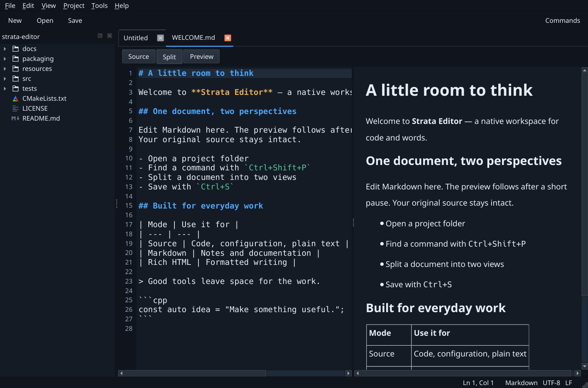

# Strata Editor

[](https://github.com/mikeholp87/strata-editor/actions/workflows/build.yml)
[](LICENSE)

A native **C++20 / Qt 6** desktop editor for plain text, source code, Markdown and formatted HTML. Keep code and writing in one workspace, with shared-document splits, a live Markdown preview and local recovery.

**0.1.2 preview:** the editing baseline is implemented, including configurable keyboard shortcuts and Source / Split / Preview modes. Advanced IDE features and large-file support remain on the [roadmap](docs/ROADMAP.md).

[Project website](https://mikeholp87.github.io/strata-editor/) · [User guide](docs/USER_GUIDE.md) · [Build instructions](docs/BUILDING.md) · [Exact feature boundaries](docs/FEATURES.md)

<picture>
  <source media="(prefers-color-scheme: light)" srcset="docs/screenshot-light.png">
  
</picture>

No telemetry, accounts, cloud services or Python/Node runtime. Editing works offline. Git operations and the external terminal use optional system tools, only when requested.

## What you can do

| Area | Implemented in this preview |
| --- | --- |
| Text and code | Draggable document tabs, line numbers, current-line highlighting, undo/redo, indentation, bracket pairing, auto-indent, word and keyword autocomplete, comments, line duplication, whitespace trimming and go to line/column. |
| Split views | Side-by-side or stacked views of the same document, with independent cursors and a shared undo history. |
| Markdown | Debounced rendering, visible Source / Split / Preview controls, a padded reading column, remembered view mode and HTML/PDF export. Source editing has bold, italic, strike, inline code, headings, bullet, numbered and task lists, quotes, links and code blocks (Markdown menu and toolbar), and Enter continues lists and quotes. Finding or editing from Preview reveals the source. |
| Formatted HTML | A dedicated visual editor with bold, italic, underline, headings, fonts, colors, lists, links, alignment and tables. Uses Qt’s supported HTML subset. |
| Find and replace | Find with expandable replacement controls; case-sensitive, whole-word and regular-expression options. Replace all is one undo transaction. |
| Project navigation | Read-only explorer, recent files/folders, fuzzy command palette, quick open from the loaded project tree and cancellable project search. |
| Keyboard shortcuts | Search commands, record keys or chords, clear/reset bindings, detect duplicate/prefix conflicts and import/export portable JSON. Changes apply only after Save. |
| File handling | Atomic saves, UTF-8 and BOM-marked UTF-16, preserved encoding/line endings, read-only checks, and external-change conflict protection with persistent Reload / Save a copy actions. |
| Workspace | Dark/light themes with separate syntax palettes, editor preferences, saved tabs/splits/layout, and recovery snapshots for unsaved documents. |
| Optional tools | Git status, branch, diff, staging, commits and history; launch a system terminal in the project folder. No embedded terminal emulation. |

Language detection and **lexical** syntax highlighting cover C/C++, Rust, Python, JavaScript, TypeScript, HTML, CSS, JSON, YAML, TOML, Bash, SQL and Markdown. This is not language-server or parser-based analysis.

## Get started

Install the Linux preview through the signed [APT repository](https://mikeholp87.github.io/apt/) or download a `.deb` from [GitHub Releases](https://github.com/mikeholp87/strata-editor/releases). Packages are built on Ubuntu 24.04 for **amd64** and install on Debian-based systems that provide Qt 6.4 or newer (see [Install with APT](#install-with-apt)). Windows ZIPs remain available from successful [Build and test runs](https://github.com/mikeholp87/strata-editor/actions/workflows/build.yml).

Requirements: a C++20 compiler, **CMake 3.22+**, and **Qt 6.4+** development packages with Widgets, Concurrent, PrintSupport and Test. Ninja is optional; omit `-G Ninja` if using another generator.

### Install with APT

The signed APT repository is the recommended way to install Strata Editor on Linux. It installs the Qt libraries for you and delivers updates through `apt upgrade`.

**Supported systems:** Debian-based Linux on **amd64** with Qt 6.4 or newer available from your distribution. Tested on Ubuntu 24.04 (the release CI installs and smoke-tests every package there) and Debian forky/sid (Qt 6.11). Other Debian and Ubuntu releases work when they provide the required `libqt6*` packages. Version 0.1.0 had Qt dependency names that Debian cannot satisfy; use **0.1.1 or newer**.

1. Add the repository key and source:

   ```sh
   sudo install -d -m 0755 /etc/apt/keyrings
   curl -fsSL https://mikeholp87.github.io/apt/apt.asc | sudo tee /etc/apt/keyrings/mikeholp87-apt.asc >/dev/null
   echo "deb [signed-by=/etc/apt/keyrings/mikeholp87-apt.asc] https://mikeholp87.github.io/apt/ ./" | sudo tee /etc/apt/sources.list.d/mikeholp87-apt.list
   ```

2. Install:

   ```sh
   sudo apt update && sudo apt install strata-editor
   ```

3. Launch `strata-editor` from a terminal or the application menu. `strata-editor --version` prints the installed version.

Optional: confirm the key fingerprint before trusting the repository.

```sh
gpg --show-keys --with-fingerprint /etc/apt/keyrings/mikeholp87-apt.asc
# E4C2 92E5 08CB 8700 6F7C  904E 7F08 D91D 3A1D 8F76
```

**Update:** `sudo apt update && sudo apt upgrade` (or `sudo apt install --only-upgrade strata-editor`).

**Remove:** `sudo apt remove strata-editor`. To also remove the repository, delete `/etc/apt/sources.list.d/mikeholp87-apt.list` and `/etc/apt/keyrings/mikeholp87-apt.asc`. Settings, sessions and recovery files stay in `~/.local/share/StrataEditor/` until you delete them.

**Without the repository:** download the `.deb` and `SHA256SUMS` from [GitHub Releases](https://github.com/mikeholp87/strata-editor/releases), run `sha256sum -c SHA256SUMS --ignore-missing`, then `sudo apt install ./strata-editor_<version>_amd64.deb`. A manually installed `.deb` does not update itself.

**Troubleshooting:** if apt reports `libqt6gui6t64 ... is not installable`, you are installing 0.1.0. Run `sudo apt update` and install again to get 0.1.1 or newer. If `strata-editor --version` shows an older version after upgrading, an earlier manual copy such as `~/.local/bin/strata-editor` is first in your `PATH`; check with `type -a strata-editor`.

### Build on Linux

Install the build dependencies, then clone and build:

```sh
sudo apt update
sudo apt install build-essential cmake ninja-build qt6-base-dev git

git clone https://github.com/mikeholp87/strata-editor.git
cd strata-editor
cmake -S . -B build -G Ninja -DCMAKE_BUILD_TYPE=Release
cmake --build build --parallel
ctest --test-dir build --output-on-failure
./build/strata-editor
```

Open a file or project folder on launch:

```sh
./build/strata-editor README.md
./build/strata-editor /path/to/project
./build/strata-editor --no-session
```

Use the existing window’s Open action if another instance is already running; one process owns the shared recovery/session storage.

### Windows

Use **MSVC 2022**, CMake and a matching Qt 6 x64 installation. In a Visual Studio developer PowerShell, replace the example Qt path with your installation:

```powershell
git clone https://github.com/mikeholp87/strata-editor.git
cd strata-editor
$strataQt = "C:/Qt/6.8.3/msvc2022_64"
$env:PATH = "$strataQt/bin;$env:PATH"
cmake -S . -B build -A x64 -DCMAKE_PREFIX_PATH="$strataQt"
cmake --build build --config Release --parallel
ctest --test-dir build -C Release --output-on-failure
.\build\Release\strata-editor.exe
```

Linux and Windows builds and behavioral tests run in [GitHub Actions](https://github.com/mikeholp87/strata-editor/actions/workflows/build.yml). Linux CI uses Ubuntu 24.04; Windows CI uses MSVC 2022 and Qt 6.8.3. Local development has been checked on Debian x86_64 with Qt 6.11.2 and X11/Xvfb. macOS, Wayland, physical printing and screen-reader behavior have not been validated.

### Install or package a local build

```sh
cmake --install build --prefix "$HOME/.local"
cpack --config build/CPackConfig.cmake -G DEB
cpack --config build/CPackConfig.cmake -G TGZ
```

The Linux packages require compatible system Qt libraries; build on the intended distribution. The TGZ is not an AppImage. Windows CI prepares a ZIP with `windeployqt`; signed Windows installers are not provided. APT handles updates to the Linux package. See [building and installation](docs/BUILDING.md) for packaging and license requirements.

Set the display name at configure time with `-DSTRATA_PRODUCT_NAME="Your Editor"`.

## Everyday use

Use **File → New Markdown** for an immediate source/preview workspace, or **New rich-text HTML** for visual formatting. HTML opens visually; use a text extension when you need to edit raw HTML source. Open a folder from the Project menu and double-click files in the explorer.

These are the default bindings; change registered commands in **Tools → Keyboard shortcuts…**:

| Action | Default shortcut |
| --- | --- |
| New / Open / Save | `Ctrl+N` / `Ctrl+O` / `Ctrl+S` |
| Save as / save a copy | `Ctrl+Shift+S` |
| Find / Find and replace | `Ctrl+F` / `Ctrl+H` |
| Next / previous match | `F3` / `Shift+F3` |
| Quick open | `Ctrl+P` |
| Command palette | `Ctrl+Shift+P` |
| Project search | `Ctrl+Shift+F` |
| Go to line and column | `Ctrl+G` |
| Duplicate line / toggle comment | `Ctrl+D` / `Ctrl+/` |
| Show completions | `Ctrl+Space` (also pops up while typing after 3 characters; `Tab` or `Enter` accepts, `Esc` dismisses) |
| Markdown bold / italic / inline code / link | `Ctrl+B` / `Ctrl+I` / `Ctrl+E` / `Ctrl+Alt+K` |
| Markdown headings 1–3 | `Ctrl+Alt+1` / `Ctrl+Alt+2` / `Ctrl+Alt+3` |
| Next document | `Ctrl+Tab` |
| Print | `Ctrl+Alt+P` |
| Preferences / focus mode | `Ctrl+,` / `F11` |

`Esc` closes Find and returns focus to the document. Shortcut imports remain drafts until Save; conflicts prevent application. Native text navigation, OS-wide shortcuts and menu mnemonics are outside the shortcut editor’s conflict checks. See the [shortcut guide](docs/USER_GUIDE.md#keyboard-shortcuts) for the JSON format and routing details.

## File safety and local data

- Saves use atomic replacement. A file changed or removed outside Strata cannot be silently overwritten; reload after reviewing or save a separate copy. Reloading a dirty buffer asks before discarding edits.
- Unsaved buffers are snapshotted every 15 seconds. Recovery is offered on startup; declining preserves the previous snapshots in a separate backup. Recovery has a **64 MiB total cap**, and a failed snapshot retains the previous one.
- Configuration uses `QSettings` under `StrataEditor/StrataEditor`; session/recovery JSON uses `QStandardPaths::AppDataLocation`. On Linux this is normally `~/.local/share/StrataEditor/strata-editor`. These files can contain unsaved document text.
- Markdown raw HTML is disabled, and document content cannot load remote images/resources. Rich HTML can normalize unsupported markup, so keep complex originals backed up.

See [security notes](SECURITY.md) and the [user guide](docs/USER_GUIDE.md) before working with important files in this preview.

## Current limits

- Files larger than **8 MiB** are refused; there is no streaming large-file viewer.
- Autocomplete suggests words from the 128 KiB around the cursor plus a short keyword list for the detected language; it is not semantic. Syntax highlighting is lexical. LSP, Tree-sitter, folding, multiple cursors, spellcheck and extensions are not implemented.
- Quick open sees entries currently loaded by the explorer, not a complete project index.
- Project search is literal and case insensitive, skips files over **2 MiB** and NUL-containing files, excludes `.git`, `node_modules` and `build`, and stops at **1,000 matches**. Ignore-file parsing and multi-file replacement are not implemented.
- Regex replacement inserts literal text; capture expansion and search-in-selection are not supported.
- Rich HTML is a visual document mode, not a lossless source editor. DOCX/RTF editing, linked preview scrolling and a Markdown table of contents are not implemented.
- Large layout, save and serialization work still runs on the UI thread within the file-size cap. No responsiveness or performance certification is claimed.

Strata is a working preview, not a complete Kate replacement. The [feature-status document](docs/FEATURES.md) records additional boundaries, including Unicode handling and recovery behavior.

## Documentation and contributing

- [User guide](docs/USER_GUIDE.md): workflows, preferences and shortcut customization
- [Build and install](docs/BUILDING.md): dependencies, packaging and diagnostic launch flags
- [Feature status](docs/FEATURES.md): what is implemented and its limits
- [Roadmap](docs/ROADMAP.md) and [release notes](docs/RELEASE_NOTES.md)
- [Architecture](docs/ARCHITECTURE.md), [development guide](docs/DEVELOPMENT.md) and [verification history](docs/VERIFICATION.md)
- [Contributing](CONTRIBUTING.md), [code of conduct](CODE_OF_CONDUCT.md) and [issue tracker](https://github.com/mikeholp87/strata-editor/issues)

Build with CMake, run CTest, and include behavioral regression coverage for file-safety changes. Keep changes focused and distinguish tested behavior from planned capabilities.

## License

Original source is [MIT licensed](LICENSE). Dynamically linked libraries retain their own [license terms and notices](THIRD_PARTY.md).

## Author

Built by [Mike Holp](https://www.ai-automation-station.com/about.html) with AI coding tools. See more build guides on [AI Automation Station](https://www.ai-automation-station.com/guides.html), and more projects at [github.com/mikeholp87](https://github.com/mikeholp87).
