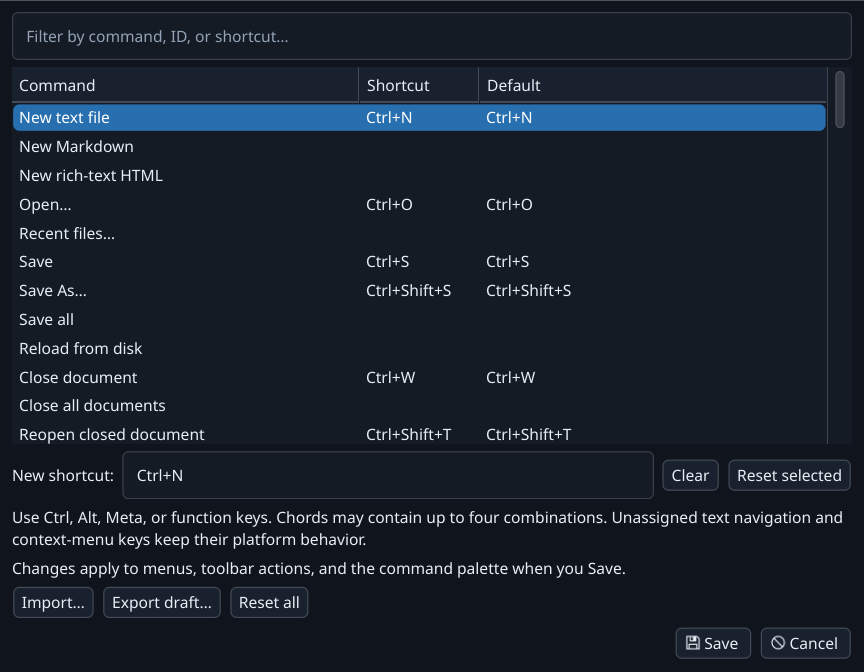

# User guide

Open files with Ctrl+O or drag them from a file manager. Open a folder from Project. Double-click explorer files. Use File → New Markdown for source/preview writing, or New rich-text HTML for formatted documents. HTML files open visually: Qt preserves supported formatting, not arbitrary page source or CSS. Keep complex original web pages backed up; use a text extension to edit raw source in this preview. Saving over an HTML file this editor did not write asks first and offers **Save a copy…**.

Save with Ctrl+S; Ctrl+Shift+S saves a copy. Modified tabs have a dot. Closing asks Save/Discard/Cancel. Closing the last tab leaves a fresh editable Untitled document; Close All also leaves one empty document. If an external change is detected, the current buffer stays intact and saving to that path fails; use the persistent document warning to Reload after reviewing, or Save a copy. The warning remains when switching tabs or moving the cursor. Cancelling either action keeps the warning and edits. Reload of a dirty buffer asks before discarding. Mixed newline files show a warning in status and normalize to the predominant convention on save. Only valid UTF-8 or BOM-marked UTF-16 opens; ambiguous/binary data and U+2029 paragraph separators are refused. NBSP and U+2028 are preserved on save.

Ctrl+F opens Find; the Replace button expands replacement controls, and Ctrl+H opens them directly. Esc closes Find and returns focus to the document. Enter/F3 finds next, Shift+F3 previous. Match case, Whole words and Regular expression flags apply. Replacements are literal strings and Replace All is a single undo transaction. Ctrl+G accepts line:column. Ctrl+D duplicates a source line, Ctrl+/ comments, Ctrl+]/[ indents/unindents. Ctrl+Tab switches tabs. Source bracket pairs and auto-indent are enabled.

Ctrl+Shift+P opens fuzzy commands. Ctrl+P filters files currently loaded in the explorer tree; expanding folders loads more entries. View contains split commands, close-extra-splits, Markdown preview, theme, wrap and panel visibility. Each editor pane shows an X header when multiple editor panes are open. Closing a pane preserves the document and undo history in the remaining pane. Markdown documents have Source, Split and Preview buttons above the document. Preview is read only, uses a bounded reading column, and remembers its view mode with the session. Finding a source match or running an editing command from Preview reveals the source. Copy and Select all act on rendered text in Preview mode. F11 toggles focus mode; a visible Exit focus mode button also restores the previous panels and toolbars. Ctrl++ and Ctrl+- resize the source-editor font, or the project-sidebar font when that tree has focus. Both sizes are remembered independently. Preferences (Ctrl+,) controls editor and project-sidebar font sizes, tab width, spaces, line numbers, session restore and recovery. HTML formatting appears only for HTML documents; Ctrl+B/I/U toggles bold/italic/underline. Formatting uses the shared undo stack.

Ctrl+Shift+F opens project search. Search is literal and case insensitive; Cancel stops the worker. Activate a result to open its line. Git panel actions require an installed Git and a project folder. Open your repository from Project, then choose Refresh status; the output identifies the working folder and shows Git errors when a folder is not a repository. Stage/Unstage currently ask for a project-relative file path. Commit runs only on your click, with your message; configured Git hooks may execute. Git output is capped at 1 MiB per command. Cancel stops status, diff or history asynchronously; stage, unstage and commit must finish before closing the window. No destructive Git action is provided. Tools → Open external terminal launches a system terminal in the project; no command is submitted.

Configuration uses QSettings (StrataEditor/StrataEditor). Session/recovery JSON uses QStandardPaths AppDataLocation (normally ~/.local/share/StrataEditor/strata-editor on Linux; platform-specific paths on Windows). Snapshots contain unsaved text and are private local data. Every 15 seconds modified buffers are atomically snapshotted. Startup offers restore; declining saves the previous snapshot as recovery-backup.json. Clean close clears active recovery after explicit save/discard decisions. An interrupted save cannot bypass external-conflict checks. Recovery also retains three previous distinct nonempty snapshots as recovery.json.bak.1 through .bak.3, newest first. Corrupt recovery data is reported and preserved under a unique recovery.json.corrupt.* name. Startup offers the newest valid backup if the primary is missing or invalid. If the corrupt primary cannot be preserved, snapshots are disabled for that session to avoid overwriting it. A valid empty primary after clean close does not restore old backups. The declined backup is separate; configurable retention is planned.

A single application instance owns recovery/session storage. A second launch asks you to use the existing window. Recovery JSON is capped at 64 MiB total; a failed/oversized snapshot leaves the previous snapshot intact and shows a warning to save your documents.

The status bar keeps cursor position, document type, encoding and line endings separate from temporary messages. Hover over document details for character/word counts, estimated reading time and indentation settings. Both themes use separate syntax colors; changing themes updates open documents. The project sidebar starts at a compact width and remains resizable.


## Keyboard shortcuts

Open **Tools → Keyboard shortcuts…**, or search for it in the command palette. Filter by command name, stable ID, or current shortcut; select a row and record a new key or chord. Use Ctrl, Alt, Meta, or function keys. Ordinary typing keys are reserved. Clear unbinds the application action, Reset selected restores one default, and Reset all restores the full default map. Save applies the whole draft; Cancel leaves active mappings and saved shortcut preferences unchanged.

Duplicate shortcuts and chord-prefix conflicts disable Save and Export. To move an existing key, first clear or change its previous command. Recording supports up to four combinations. Print defaults to **Ctrl+Alt+P**, while Quick Open retains **Ctrl+P**.

Import reads a version-1 JSON configuration into the draft; it does not apply automatically. Export draft saves the draft without applying it. Omitted command IDs reset to their defaults; an empty string unbinds an action. Unknown commands, unsupported versions, malformed/noncanonical key strings, and files over 256 KiB are rejected without replacing the draft. Use an exported file as a starting point. Example:

```json
{
  "format": "strata-shortcuts",
  "version": 1,
  "bindings": {
    "new": "Ctrl+Alt+N",
    "newMarkdown": "Ctrl+K, Ctrl+M",
    "duplicate": ""
  }
}
```

Mappings persist in QSettings under `shortcuts/v1`. Stable IDs remain independent of translated labels. Menus, toolbar actions and the command palette share the updated actions. Source and rich-text editors allow those registered keys to take precedence over native editing shortcuts. Unassigned native text navigation and the widgets’ native context-menu bindings retain platform behavior; clearing an application binding does not disable every equivalent Qt text-widget key. OS global shortcuts and menu mnemonics are outside this editor’s conflict check.



The main window remembers its size, maximized state and dock layout on a successful close, including when opening with `--no-session` or disabling document-session restoration. Preferences, the command palette, Quick Open and the shortcut editor each remember their own window geometry when closed, accepted or cancelled. Cancelling a dialog still leaves its editable preferences unchanged; remembering its size is independent of accepting those changes.

Documents whose encoded save would exceed 8 MiB are refused before the original is replaced. `--no-session` preserves the previous workspace and recovery files and disables recovery snapshots for that invocation. Project search supports UTF-8 and BOM-tagged UTF-16; results are cleared on project changes. Markdown printing uses the rendered document.
